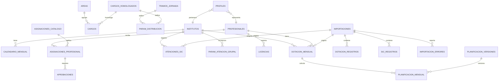

# Modelo de datos

Base de datos PostgreSQL 17 en Supabase. Todas las tablas de negocio viven en `public`.
Las migraciones están en `supabase/migrations/` y se aplican con `supabase db push --remote`.

## ERD

## Diccionario por dominio

### Catálogos

| Tabla | Propósito | Campos clave |
|---|---|---|
| `institutos` | Centros Teletón | `codigo`, `region`, `zona` |
| `areas` | Área/especialidad | `atencion_grupal` |
| `cargos_homologados` | Agrupación para distribución | `codigo`, `nombre` |
| `cargos` | Cargo BUK | `area_id`, `cargo_homologado_id` |
| `tramos_jornada` | ≥40 / 22–40 / <22 h | `horas_min`, `horas_max`, `orden` |
| `tipos_contrato` | Indefinido, plazo fijo, reemplazo | `codigo` |
| `periodos_planificacion` | 44 h hasta abril, 42 h desde mayo | `mes_inicio`, `mes_fin`, `horas_jornada_legal` |

### Parámetros editables (con vigencia)

| Tabla | Propósito |
|---|---|
| `param_distribucion` | % directo / indirecto / NAS por cargo homologado y tramo |
| `param_minutos_atencion` | Minutos estándar por cargo y tipo de atención |
| `param_atencion_grupal` | % grupal y pacientes por grupo; `instituto_id NULL` = regla general |
| `asignaciones_catalogo` | Catálogo de asignaciones y horas semanales |
| `parametros_sistema` | Meta 90 %, máximo de asignaciones, umbrales |
| `feriados` | Nacionales y regionales |
| `calendario_mensual` | Días hábiles, inhábiles y vacaciones por instituto/mes |

Todas usan `vigencia_desde` / `vigencia_hasta` y constraints `EXCLUDE` para impedir solapamientos.

### Dotación BUK

| Tabla | Propósito |
|---|---|
| `importaciones` | Cabecera de carga; `archivo_hash` único para idempotencia |
| `importacion_errores` | Errores y advertencias por fila/columna |
| `dotacion_registros` | Fila cruda JSONB del reporte |
| `profesionales` | Código BUK + nombre seudónimo |
| `dotacion_mensual` | Profesional × instituto × mes; multi-instituto, reemplazo, vacante |
| `licencias` | Ausencias que reducen días efectivos |
| `cambios_dotacion` | Diff detectado en cada importación |

### Asignaciones y SIC

| Tabla | Propósito |
|---|---|
| `asignaciones_profesional` | Horas semanales, vigencia y estado |
| `aprobaciones` | Historial de aprobación/rechazo |
| `sic_registros` | Fila cruda SIC |
| `atenciones_sic` | Atenciones directas/indirectas por profesional/mes |

### Planificación

| Tabla | Propósito |
|---|---|
| `planificacion_versiones` | Versión por año, estado y aprobación |
| `planificacion_mensual` | Resultado por profesional/instituto/mes + `detalle` JSONB |
| `simulaciones` | Snapshot de cambios de parámetros y resultado |

### Seguridad

| Tabla | Propósito |
|---|---|
| `profiles` | `auth.users` → rol, instituto y profesional |
| `auditoria` | Antes/después, usuario, justificación y timestamp |

## Vistas

| Vista | Uso |
|---|---|
| `v_planificacion_vigente` | Última versión por año, con datos completos |
| `v_planificacion_nacional` | Agregado país por mes |
| `v_planificacion_instituto` | Instituto × área × cargo × mes |
| `v_planificacion_profesional` | Detalle por profesional/mes |
| `v_cumplimiento_sic` | Planificado vs ejecutado (solo meses con SIC) |
| `v_alertas_desviacion` | Desviaciones sobre el umbral |
| `v_foja_mensual` | FOJA por instituto/mes |
| `v_dotacion_inconsistencias` | Horas excedidas o calendario faltante |

Todas usan `security_invoker = true`, por lo que respetan RLS.

## Matriz RLS

| Tabla | Central | Dirección | Jefatura | Profesional |
|---|---|---|---|---|
| Catálogos y parámetros | RW | R | R | R |
| `profesionales` | RW | R | R (su instituto) | R (sí mismo) |
| `dotacion_mensual` | RW | R | R (su instituto) | R (sí mismo) |
| `licencias`, `cambios_dotacion` | RW | R | R (su instituto) | R (sí mismo) |
| `asignaciones_profesional` | RW | RW | R + insertar | R (sí mismo) |
| `aprobaciones` | RW | RW | R (su instituto) | R (sí mismo) |
| `atenciones_sic` | RW | R | R (su instituto) | R (sí mismo) |
| `planificacion_mensual` | RW | R | R (su instituto) | R (sí mismo) |
| `planificacion_versiones` | RW | R | R | R |
| `importaciones` / registros crudos | RW | R | — | — |
| `auditoria` | R | R | — | — |
| `simulaciones` | RW | R | — | R (propias) |

`service_role` omite RLS y se usa solo para la ingesta de Blue Prism y tareas de CI.

## Supuestos de cálculo v1

1. **Horas contratadas del mes** = horas semanales × días efectivos / 5.
2. **Días efectivos** = días hábiles − vacaciones del instituto − licencias del profesional
   (contadas como días hábiles).
3. **Promedio anual** = suma ponderada de horas semanales por días hábiles / suma de días hábiles.
4. **Tramo** = rango de `tramos_jornada` que contiene el promedio.
5. **Asignaciones** = horas semanales aprobadas × días efectivos / 5, prorrateadas por instituto.
6. **Distribución** = `param_distribucion` vigente al primer día del mes.
7. **Atenciones directas** = `floor(horas directas individuales × 60 / minutos)` +
   `floor(horas directas grupales × 60 / minutos) × pacientes por grupo`.
8. **Atenciones indirectas** = `floor(horas indirectas × 60 / minutos indirectos)`.
9. **Meta de Gestión** = atenciones totales × `meta_gestion` (0,90 por defecto).
10. **FOJA** = horas directas / horas contratadas.

Cada fila de `planificacion_mensual.detalle` guarda los insumos usados (días, minutos,
porcentajes, pacientes por grupo, etc.) para poder auditar y recalibrar.

## Cómo extender cuando llegue el Excel

1. Agregar una migración nueva; nunca editar una ya aplicada.
2. Si el reporte trae columnas nuevas, ya quedan en `dotacion_registros.payload` / `sic_registros.payload`.
3. Si cambia una regla, insertar una nueva fila en la tabla de parámetros con nueva vigencia.
4. Si cambia la fórmula, crear `fn_generar_planificacion_v2` y registrar `motor_version` en
   `planificacion_versiones`.
5. Recalcular con `select fn_generar_planificacion(2026, 'Calibración Excel');`.
